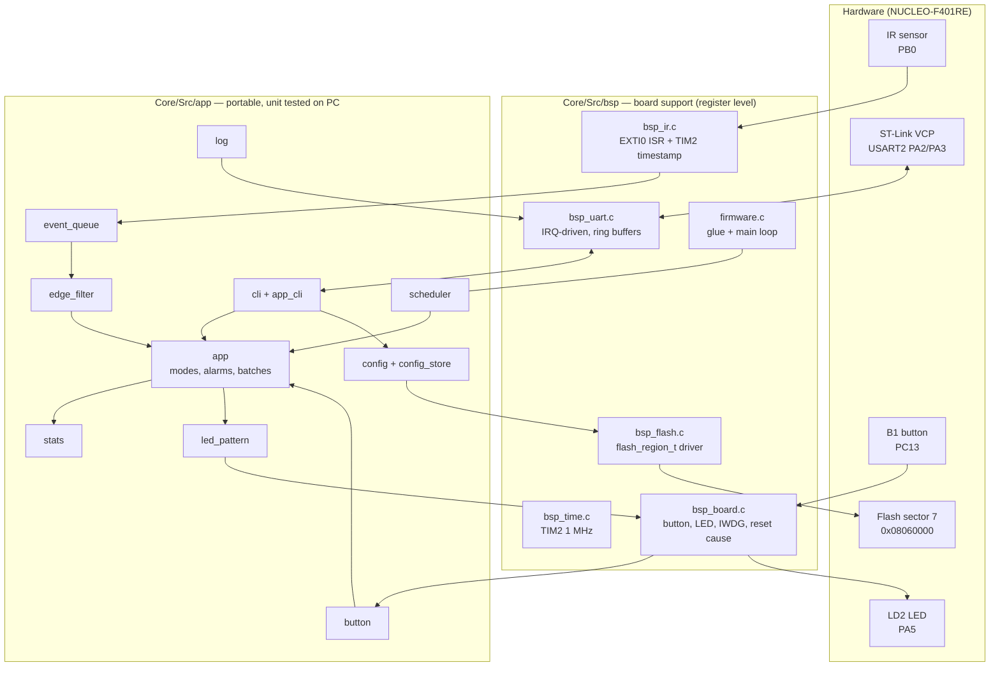

# IRSense architecture

## Layers



The rule: **nothing in `app/` includes a HAL or CMSIS header.** Hardware
access goes through small interfaces (`flash_region_t`, `app_port_t`,
`app_platform_t`, function pointers for clocks and output). That keeps the
interesting logic testable on a PC (`tests/`), with sanitizers, in CI.

CubeMX owns `main.c`, `stm32f4xx_it.c`, `stm32f4xx_hal_msp.c` and the
`.ioc`. The project only touches them inside `USER CODE` blocks (two calls
in `main.c`). Every extra peripheral (TIM2, USART2, EXTI0, IWDG) is
configured in `bsp/`, so **Project → Generate Code** never removes it.

## Data path of one object

```
 IR output   ‾‾‾‾‾‾|________________|‾‾‾‾‾‾‾      (active low: LOW = object)
                   t0               t1
 EXTI0 ISR    push {t0, level 0}   push {t1, level 1}         (~1 µs each)
 main loop    edge_filter: level stable for debounce_us?
              -> app_on_beam(blocked, t0)   -> app_on_beam(clear, t1)
 app          width = t1 - t0, gap = t0 - previous t0
              stats, batch counter, LED blip, $OBJ record
```

* **Timestamps are taken in the ISR** from the 32-bit TIM2 counter at 1 MHz,
  so width and gap are accurate to about 1 µs, however busy the main loop is.
* **The glitch filter reports the original edge time.** Filtering adds
  latency (`debounce_us`), not measurement error.
* **Race-free hand-off.** The main loop reads the clock only after the queue
  is empty. An edge that arrives later always has a newer timestamp, so the
  filter can't confirm a level that already ended.
* **Lost edges are detected and repaired.** A full queue increments
  `dropped`, which raises the `OVERFLOW` alarm. The health task re-syncs the
  filter with the actual pin level.

## Concurrency model

| Context | Runs | Talks to main loop via |
|---|---|---|
| `EXTI0_IRQHandler` (prio 1) | every IR edge | `event_queue_t` (lock-free SPSC) |
| `USART2_IRQHandler` (prio 5) | RX byte / TX empty | two `ring_buffer_t` (lock-free SPSC) |
| `SysTick_Handler` | 1 kHz | `HAL_GetTick()` |
| main loop | always | — |

There are no RTOS and no mutexes. Each queue has exactly one producer and one
consumer. Indices are free-running 32-bit counters, and a compiler barrier
orders the data write before the index publish (enough on a single-core
Cortex-M4). The main loop sleeps in `__WFI()` when idle.

## Scheduler tasks

| Task | Period | Job |
|---|---|---|
| `button` | 5 ms | debounce B1, detect short / double / long press |
| `app` | 10 ms | jam / rate alarms, guard arming, LED pattern choice |
| `led` | 10 ms | drive LD2 from the pattern engine |
| `health` | 100 ms | kick watchdog, overflow checks, pin re-sync |
| `report` | 60 s | log a one-line summary |

`tasks` on the CLI shows run counts, overruns and worst-case execution time
(measured with TIM2).

## Config storage

```
sector 7 (128 KiB)
┌──────────┬──────────┬──────────┬─────┬──────────┬───────────────┐
│ record 1 │ record 2 │ record 3 │ ... │ record N │ 0xFF (erased) │
└──────────┴──────────┴──────────┴─────┴──────────┴───────────────┘
record = magic | seq | layout | config_t (9 x u32) | CRC-32   (52 bytes)
```

* `save` appends a record. `load` takes the valid record with the highest
  `seq`.
* The sector is erased only when full: ~2500 saves per erase cycle, which
  multiplies the 10 k-cycle flash endurance accordingly.
* A reset during a save leaves a record with a bad CRC. Load skips it and
  the previous settings survive (unit tested with fault injection).
* A changed `config_t` layout (`layout` word) or an out-of-range value makes
  a record invalid, so defaults load instead of garbage.

## Fault handling

| Fault | Detection | Reaction |
|---|---|---|
| Main loop hangs | IWDG, 8 s (covers a worst-case sector erase) | reset; `reset: independent watchdog` logged at boot |
| Beam blocked too long | `jam_ms` | `JAM` alarm, fast blink |
| Too many objects | `rate_alarm` | `RATE` alarm with 10 % hysteresis |
| ISR queue overflow | `dropped` counter | `OVERFLOW` alarm and pin re-sync |
| UART RX overrun | ORE flag | warning in the log, counter in `sys` |
| Terminal too slow | TX buffer full > 50 ms | bytes dropped (counted), firmware never blocks |
| Corrupt config | CRC / range check | falls back to defaults |
